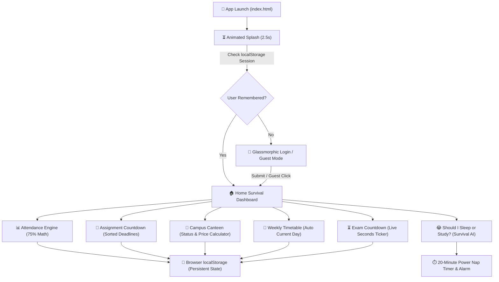

# 🎓 Student Survival App 🧑‍🎓🔥
> **Tagline:** *“Survive college. One deadline at a time. 😂”*  
> **Subtitle:** *“Because college is already hard enough 😭”*  
> **Status:** Fully Functional & Ready to Run

---

## 🖼️ Application Visual Identity

The uploaded **“Life of a Student”** hand-drawn notebook illustration is the core aesthetic foundation of the entire app: [life-of-a-student.jpg](file:///C:/Users/DELL/.gemini/antigravity/scratch/student-survival-app/assets/life-of-a-student.jpg)

### Dual Implementation:
1. **App Icon & Logo Crop**:
   - Styled as a rounded-square badge with subtle gradient glow and shadow.
   - Featured on the **Animated Loading Splash Screen**, the **Glassmorphism Login Card**, the **Top Sticky Navigation Header**, and the **Student Profile**.
2. **Full-Screen Fixed Background**:
   - Styled with `background-size: cover; background-position: center; background-attachment: fixed;`.
   - Covered with a dark translucent glassmorphic overlay (`backdrop-filter: blur(16px)`), ensuring all text, badges, and progress bars maintain AAA contrast while keeping the spiral notebook, pencils, ruler, crushed student, and teacher recognizable in the background.
   - On mobile screens, smartly anchored so the notebook title and key illustration remain in focus.

---

## 🏗️ System Architecture & Workflow

---

## ⚡ Quick Launch Guide

> [!TIP]
> The app is 100% client-side with zero build steps or external package dependencies required.

You can launch and test the app from either location:

| Location | Path | Usage |
| :--- | :--- | :--- |
| **Workspace (Recommended)** | [`student-survival-app/index.html`](file:///C:/Users/DELL/.gemini/antigravity/scratch/student-survival-app/index.html) | Main working directory |
| **Desktop Shortcut** | [`student-survival-app/index.html`](file:///C:/Users/DELL/OneDrive/Desktop/student%20survival/student-survival-app/index.html) | Direct desktop launcher |

### To Run:
- Double-click **`index.html`** to open in **Google Chrome**, **Microsoft Edge**, **Brave**, **Firefox**, or **Safari**.
- Use the **Skip to App** button on the splash screen or wait ~2.5 seconds to experience the animated collegiate quotes.

---

## 🧮 Core Engines & Mathematical Formulas

### 1. Attendance Bunk & Shortage Engine
- **Attendance Percentage**:
  $$\text{Attendance } \% = \left(\frac{\text{Attended Classes}}{\text{Total Classes}}\right) \times 100$$
- **Safe Bunk Allowance** ($\ge 75\%$):
  $$\text{Safe Bunks} = \left\lfloor \frac{\text{Attended} - 0.75 \times \text{Total}}{0.75} \right\rfloor$$
- **Consecutive Attendance Needed to Escape Detention** ($< 75\%$):
  $$\text{Classes Needed} = \left\lceil \frac{0.75 \times \text{Total} - \text{Attended}}{0.25} \right\rceil$$

### 2. 🔔 Real-Time Notification Bar & Time-to-Time Reminder Engine
- **Sticky Top Notification Ticker**:
  - Sits directly below the header with urgency color-coding (🔴 Critical Red, 🟡 Warning Amber, 🟣 Exam Purple).
  - Automatically scans and surfaces upcoming deliverables (*“DBMS Normalization due in 2 days!”*), imminent exams (*“OOP / Java Exam in 12 days!”*), and attendance shortages (*“COA attendance is 60% — attend 21 classes!”*).
  - Smooth auto-cycling progress line (cycles every 7 seconds) with manual previous `<` / next `>` arrows, pause/resume, and direct action jump buttons (*“Do It Now 🚀”*).
- **Time-to-Time Periodic Reminders**:
  - Configurable timer (1 min demo mode, 3 mins, 10 mins, 30 mins, 1 hour) that fires periodic check-in audio chimes and collegiate humor toasts.
  - Native **Web Notification API** integration for desktop push notifications outside the browser tab.
- **Notification Center Drawer**:
  - Accessed via the 🔔 Bell icon in the top header with a live unread alert badge.
  - Lists all pending tasks categorized by urgency with 1-click navigation.

### 3. 🎓 Academic Survival Score ($0 - 100$)
- **Weighted Health Indicator**:
  - Attendance Health ($45\%$ weight)
  - Assignment Backlog ($35\%$ weight)
  - Closest Exam Buffer ($20\%$ weight)
- Visualized with an animated SVG radial progress ring and collegiate ranking titles (*Academic Comeback King 🔥*, *Surviving on Caffeine ☕*, *God Help You 💀*).

---

## 📱 Mobile-First Features

- **Bottom Navigation Bar**: Native app ergonomics with 1-touch tabs for **Home**, **Attend**, **Tasks**, **Schedule**, and **Exams**.
- **Touch-Friendly Buttons**: Minimum $44\text{px}$ touch targets.
- **Web Audio API**: Crisp pops, celebratory completion chimes, and alarm bells synthesized in pure code without loading external MP3 files.
- **Data Persistence**: All records (attendance edits, newly scheduled classes, assignments marked done, canteen toggles) persist through browser reloads via `localStorage`.

---

## 🧑‍🎓 Indian Student Demo Accounts & Registration Engine

The login screen now includes a dedicated **[ ➕ Create Account ]** tab alongside **1-Click Quick Demo Login** pills for 5 authentic Indian student personas:

| Student Name | Username | College Email | Password | College / Branch | Sem | Status |
| :--- | :--- | :--- | :--- | :--- | :--- | :--- |
| **Aman Sharma** | `aman_sharma` | `aman.sharma@college.edu` | `password123` | DTU • CSE | 4 | 🟢 80% Attendance (Safe) |
| **Priya Patel** | `priya_patel` | `priya.patel@nit.ac.in` | `priyapassword` | NIT Trichy • IT | 4 | 🟢 88% Attendance (Safe) |
| **Rahul Verma** | `rahul_v` | `rahul.verma@vit.edu.in` | `rahulpass2026` | VIT • ECE | 4 | 🔴 65% Shortage Alert |
| **Ananya Iyer** | `ananya_iyer` | `ananya.iyer@bits-pilani.ac.in` | `ananyapass` | BITS Pilani • AI & DS | 6 | ⭐ 92% College Topper |
| **Rohan Gupta** | `rohan_gupta` | `rohan.gupta@iitd.ac.in` | `rohanpass` | IIT Delhi • CSE | 4 | 🟡 72% Borderline Warning |

### Key Features of Account Management:
1. **Interactive Tab Switching**: Smooth toggle between `[ 🔑 Sign In ]` and `[ ➕ Create Account ]`.
2. **Registration Form**: Captures Full Name, Username, College Email, Password, College/University, Branch, Semester, and Target Attendance % (75%, 80%, 85%, 90%).
3. **Local Account Persistence**: Newly registered accounts are stored in `localStorage` under `registeredUsers`, allowing users to log out and log back in seamlessly with their custom credentials.
4. **1-Click Demo Evaluation**: Click any of the student cards on the sign-in screen to instantly load that student's full semester data, subjects, attendance percentages, and personalized collegiate quotes!

---

*Made by students, for students ❤️*  
*“Now go study... or at least pretend to. 😂”*

